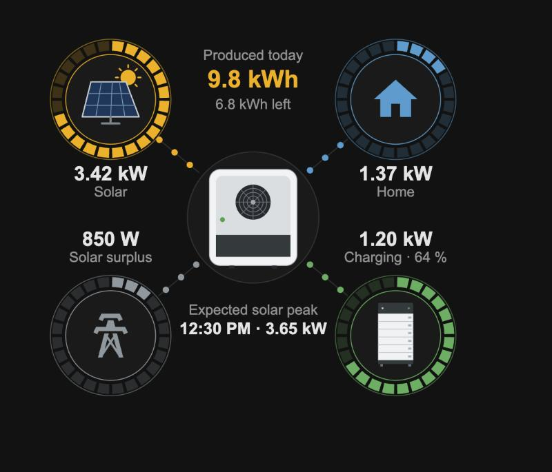
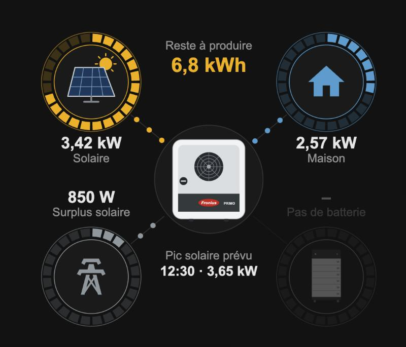
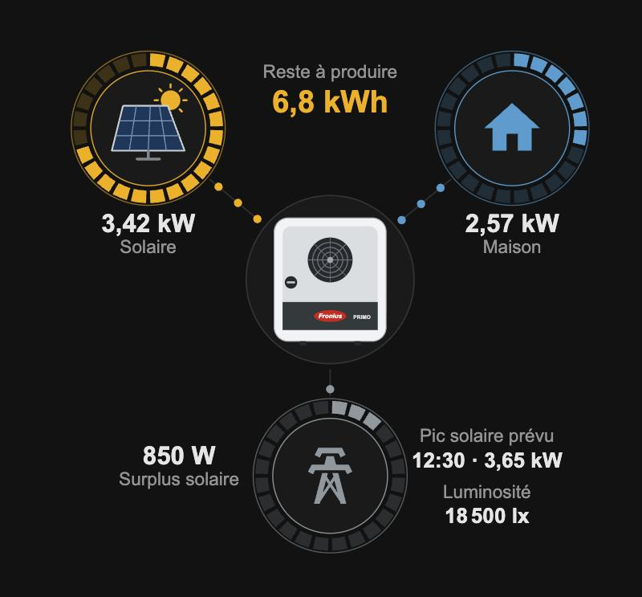

# Fronius Flow Card

An energy-flow card for Home Assistant, built for Fronius installations: the inverter sits in the middle and is linked to the solar panels, the home, the grid and the battery. Animated dots show where the power flows, and each ring fills up with the power (or the battery's state of charge).



Without a battery (French): greyed out, or `show_missing_battery: false`

 

*Version française plus bas.*

## Features

- **Zero configuration for most setups**: the entities of the official **Fronius** integration, of **Fronius Modbus** and of **Solcast PV Forecast** are detected automatically.
- **Visual editor**: every entity can be replaced from the card editor; the detected one is shown under each field.
- Works **with or without a battery**: without one, the battery is shown greyed out, or removed with the grid at the bottom centre (`show_missing_battery: false`).
- **Home consumption** comes from the Fronius "load" sensor, or is computed (solar + grid + battery) when none is available.
- Optional lines: energy produced today, Solcast forecast left today, expected solar peak, brightness sensor.
- English and French, following the Home Assistant language.
- Click any element to open its history.

## Installation

### Marketplace / HACS (custom repository)

1. Open **Settings → Marketplace** (HACS on Home Assistant 2026.10 and older).
2. Menu **⋮ → Add from link** (HACS: *Custom repositories*), paste `https://github.com/tsrz/fronius-flow-card` and choose the type **Dashboard** (HACS: *Lovelace* / *Dashboard*).
3. Install **Fronius Flow Card**, then reload your browser.

### Manual

1. Download `fronius-flow-card.js` from the latest release and copy it to `/config/www/`.
2. **Settings → Dashboards → ⋮ → Resources → Add**: URL `/local/fronius-flow-card.js`, type *JavaScript module*.
3. Reload your browser.

## Usage

Add the card from the dashboard editor (search for *Fronius Flow Card*), or in YAML:

```yaml
type: custom:fronius-flow-card
```

That's all if your entities are detected. Otherwise, set them in the visual editor or in YAML:

```yaml
type: custom:fronius-flow-card
solar_entity: sensor.solarnet_power_photovoltaics
grid_entity: sensor.solarnet_power_grid
battery_entity: sensor.solarnet_power_battery
soc_entity: sensor.battery_state_of_charge
today_entity: sensor.pv_energy_today
remaining_entity: sensor.solcast_pv_forecast_forecast_remaining_today
peak_time_entity: sensor.solcast_pv_forecast_peak_time_today
peak_power_entity: sensor.solcast_pv_forecast_peak_forecast_today
lux_entity: sensor.outdoor_illuminance
```

### Options

| Option | Default | Description |
|---|---|---|
| `solar_entity` | detected | Solar (PV) power. |
| `grid_entity` | detected | Grid power, **positive = import**, negative = export. |
| `grid_import_entity` / `grid_export_entity` | detected | Use these two instead of `grid_entity` if your grid power is split. |
| `battery_entity` | detected | Battery power, **positive = discharge**, negative = charge. |
| `battery_charge_entity` / `battery_discharge_entity` | detected | Use these two instead of `battery_entity` if your battery power is split. |
| `soc_entity` | detected | Battery state of charge (%). |
| `home_entity` | detected | Home consumption. When missing, it is computed as solar + grid + battery. |
| `today_entity` | detected | Energy produced today (kWh or Wh). |
| `remaining_entity` | detected | Solcast forecast left today. |
| `peak_time_entity` / `peak_power_entity` | detected | Solcast expected peak time and power. |
| `lux_entity` | — | Optional brightness sensor. |
| `auto_detect` | `true` | Fill the missing entities automatically. Set `false` to use only the ones you configured. |
| `invert_grid` / `invert_battery` | `false` | Invert the sign if your sensor uses the opposite convention. |
| `show_missing_battery` | `true` | Without a battery, show it greyed out. Set `false` for a 3-element layout with the grid at the bottom centre. |
| `inverter_logo` | `true` | Show the small Fronius logo on the inverter drawing. |
| `inverter_label` | empty | Short text written on the inverter (e.g. `PRIMO`). |
| `solar_max` / `home_max` / `grid_max` | 5000 / 10000 / 10000 | Power (W) that fills the whole ring. |
| `min_flow` | `20` | Below this power (W), no flow is shown. |

Power sensors in W or kW and energy sensors in Wh or kWh are converted automatically.

### Tip: "energy produced today"

Recent Fronius inverters (GEN24) don't provide a daily energy sensor. Create one with a **Utility Meter** helper (daily cycle) on your PV energy sensor, or with the **Integral** helper on the PV power sensor, then select it as `today_entity`. Without it, the card shows the Solcast forecast left today instead.

---

## Version française

Une carte de flux d'énergie pour Home Assistant, pensée pour les installations Fronius : l'onduleur au centre, relié aux panneaux solaires, à la maison, au réseau et à la batterie.

- **Sans configuration** dans la plupart des cas : les entités des intégrations **Fronius** (officielle), **Fronius Modbus** et **Solcast** sont détectées automatiquement.
- **Éditeur visuel** : chaque entité peut être remplacée ; celle qui a été détectée est indiquée sous chaque champ.
- Fonctionne **avec ou sans batterie** : sans batterie, elle est affichée en grisé, ou retirée avec le réseau en bas au centre (`show_missing_battery: false`).
- **Consommation de la maison** : capteur « charge » de Fronius, ou calculée (solaire + réseau + batterie).
- Lignes facultatives : production du jour, prévision restante Solcast, pic solaire prévu, luminosité.
- En français ou en anglais, selon la langue de Home Assistant.

**Installation** : *Paramètres → Marketplace → ⋮ → Ajouter depuis un lien*, coller `https://github.com/tsrz/fronius-flow-card`, type **Tableau de bord**, installer, puis recharger le navigateur. Ajouter ensuite la carte *Fronius Flow Card* au tableau de bord.

**Conventions de signe** : réseau positif = achat ; batterie positive = décharge. Les options `invert_grid` et `invert_battery` inversent le signe si besoin.

---

## Disclaimer

This is a community project. It is **not affiliated with, endorsed by or supported by Fronius International GmbH**. "Fronius" and the Fronius logo are trademarks of their owner; they are used here only to identify compatible hardware, and the logo can be hidden with `inverter_logo: false`. The battery drawing is generic.

## License

[MIT](LICENSE)
